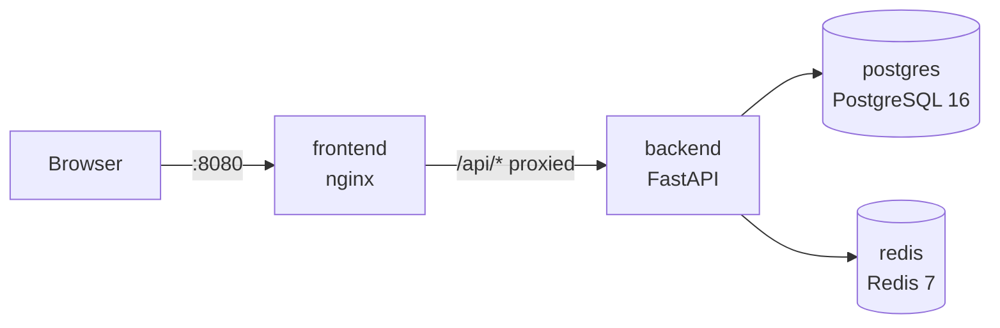

# Multi-Container Application Platform

A four-container stack (nginx frontend → FastAPI backend → PostgreSQL → Redis) orchestrated with Docker Compose. It's built to demonstrate **container concepts**, not just Docker commands: networking, service discovery, volumes, environment variables, health checks, and restart policies.

## Architecture



All four containers run independently on one user-defined Docker network (`app-net`). Only the frontend is published to the host.

## Concepts demonstrated

| Concept | How it's demonstrated | Where |
|---|---|---|
| Container networking | One bridge network; only port 8080 is published, so backend, Postgres and Redis are unreachable from the host | `docker-compose.yml` |
| Service discovery | Containers address each other by service name (`postgres`, `redis`, `backend`) through Docker's embedded DNS | `docker-compose.yml`, `frontend/nginx.conf` |
| Volumes | Named volumes `pgdata` and `redisdata` survive `docker compose down` | `docker-compose.yml` |
| Environment variables | Secrets live in a git-ignored `.env`; `.env.example` documents the shape; the app reads config from the environment | `.env.example`, `backend/app/database.py` |
| Health checks | Postgres (`pg_isready`), Redis (`redis-cli ping`), backend and frontend (Dockerfile `HEALTHCHECK`); startup is ordered with `depends_on: condition: service_healthy` | `docker-compose.yml`, Dockerfiles |
| Restart policies | `restart: unless-stopped` on every service | `docker-compose.yml` |

## Quick start

```bash
git clone https://github.com/<your-username>/multi-container-platform.git
cd multi-container-platform
cp .env.example .env        # then change the password
docker compose up -d --build
```

Open <http://localhost:8080>.

## Verify each concept yourself

**Startup ordering and health**
```bash
docker compose ps
```
All four services should show `(healthy)`.

**Service discovery**
```bash
docker compose exec frontend nslookup backend
```
The name resolves through Docker's DNS server at `127.0.0.11`.

**Network isolation**
```bash
curl -s -m 3 http://localhost:8000/health || echo "backend not reachable from the host"
curl -s http://localhost:8080/api/health
```
The backend is only reachable through the nginx proxy.

**Persistence**

Add an item in the UI, then:
```bash
docker compose down
docker compose up -d
```
The item is still there. `docker compose down -v` deletes the volumes and wipes the data.

**Restart policy**
```bash
docker compose exec backend python -c "import os, signal; os.kill(1, signal.SIGTERM)"
sleep 10
docker compose ps
docker inspect -f '{{.RestartCount}}' $(docker compose ps -q backend)
```
The backend's main process exits on its own, and Docker restarts it (`RestartCount` is 1). Note that `docker stop` and `docker kill` count as manual stops, so `unless-stopped` deliberately leaves the container down.

## Project structure

```
.
├── backend/            # FastAPI app + Dockerfile (HEALTHCHECK baked in)
├── frontend/           # static HTML/JS + nginx.conf (reverse proxy) + Dockerfile
├── docker-compose.yml
├── .env.example        # copy to .env
└── README.md
```

## Design notes

- **Why an nginx reverse proxy?** The browser runs outside the Docker network, so it can't resolve container names. nginx serves the static page and proxies `/api/` to `backend`.
- **Why a variable in `proxy_pass`?** With a literal hostname, nginx resolves it once at startup and caches the IP, which breaks when the backend container is recreated. A variable plus `resolver 127.0.0.11` makes nginx re-resolve at request time.
- **Why `pg_isready -h 127.0.0.1`?** On a fresh volume Postgres first runs a temporary server that listens only on a local socket. Forcing a TCP check means "healthy" only once the real server accepts connections.
- **Why psycopg 3?** `psycopg2-binary` had no prebuilt wheel for the newest Python at the time. The image pins Python 3.12, independent of the host's Python.
- **Secrets vs config:** passwords come from `.env`; hostnames and ports are plain config in the Compose file.

## Known limitations and next steps

- `POST /items` takes a query parameter rather than a JSON body.
- Tables are created at startup with `create_all`; a real deployment would use migrations (Alembic).
- Credentials in `.env` are for local development only.
- A second network could isolate the database tier so the frontend can't reach Postgres at all.
